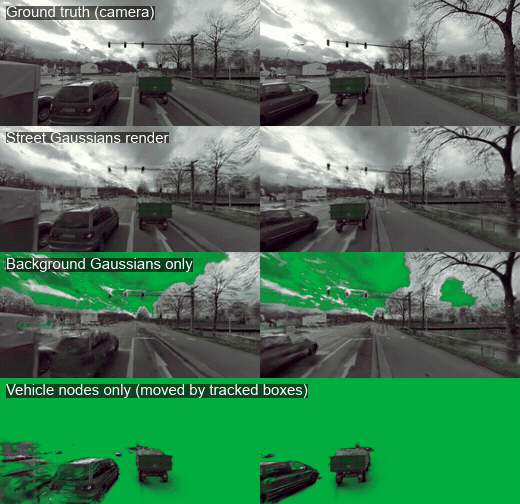
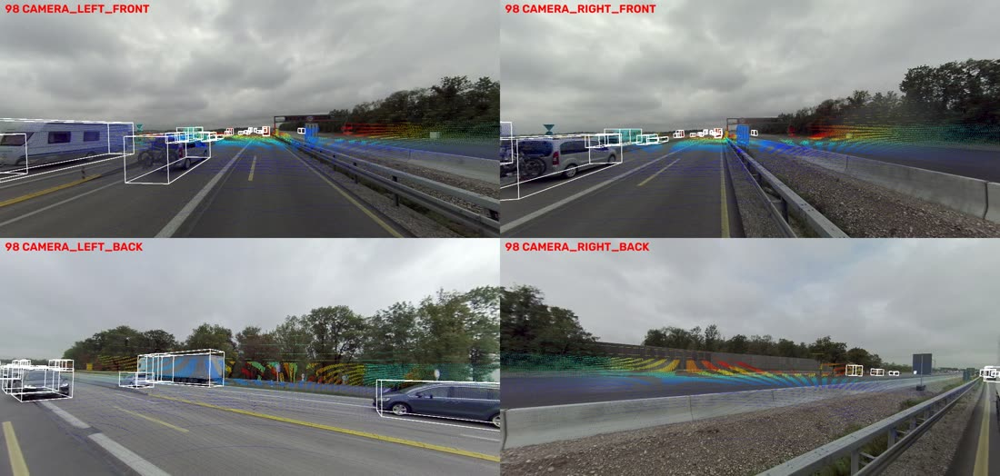
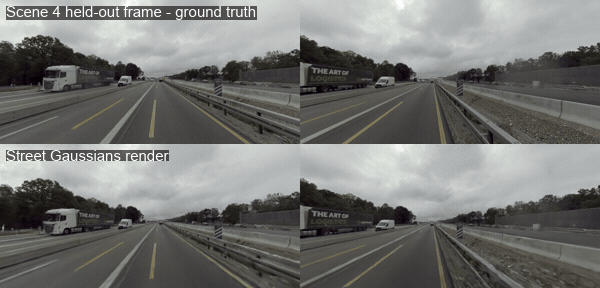
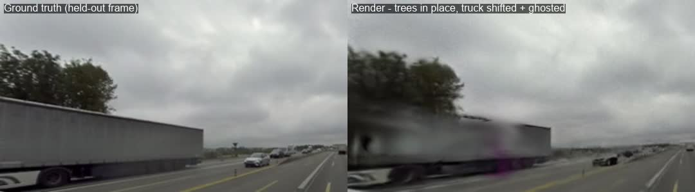

# Street Gaussians on MAN TruckScenes（卡车自动驾驶场景的动态 3DGS 重建）

> **English summary.** An adapter that brings the [MAN TruckScenes](https://registry.opendata.aws/man-truckscenes/) truck dataset
> (6 LiDARs, tractor + trailer, highway speeds) into [drivestudio](https://github.com/ziyc/drivestudio), plus Street
> Gaussians reconstructions of several mini-split scenes on a single 8 GB laptop GPU, and an analysis of where the
> method breaks: fast-moving vehicles on highways.



*Scene 2（城区，低速）。从上到下：真实相机画面 / Street Gaussians 渲染 / 只渲染静态背景 / 只渲染车辆节点（随 3D 跟踪框移动）。
绿色 = 该部分没有内容（天空由单独的天空模型负责）。完整视频：[assets/scene2_decomposition.mp4](assets/scene2_decomposition.mp4)*

**亮点（30 秒版）**
- 把**卡车**数据集（6 个 LiDAR、牵引车 + 挂车、高速）接入 drivestudio，跑通 Street Gaussians 动态场景重建
- 7 个场景批量实验（城区 / 高速，不同天气、车速），单张 8 GB 笔记本显卡完成
- 发现并定位失败模式：**高速场景中车辆被渲染到错误位置**；查到适配层的时间对齐问题并给出修复（见"分析"）

## 这个项目做了什么

1. **把卡车数据集接入 drivestudio**（drivestudio 原生只支持 Waymo / nuScenes / PandaSet 等乘用车数据集）
   - `addon/datasets/truckscenes/truckscenes_preprocess.py`：TruckScenes → drivestudio 场景格式
     - **6 个 LiDAR 融合**：每个 LiDAR 用各自时刻的自车位姿变换到世界坐标，再统一到参考帧，避免高速下多雷达之间的运动错位
     - **去掉自车点云**：牵引车 + 挂车会出现在 LiDAR 里，按自车坐标系的盒子剔除
     - **2 Hz 标注 → 10 Hz**：跟踪框位置线性插值、朝向球面插值（Slerp）
     - 新类别映射（`vehicle.other`、`vehicle.train` → 刚体；`vehicle.ego_trailer` 自己的挂车 → 不建模）
     - 每个场景输出 LiDAR + 跟踪框投影到相机的检查图，确认标定和时间同步正确：

       

       *场景 4 第 98 帧（4 个相机）：LiDAR 点按深度着色，白框为 3D 跟踪框。注意左后相机里的蓝色卡车：这一帧不是标注帧，
       框是插值出来的，已经比车身略微靠前，这正是下面"分析"部分的问题。*
   - `addon/datasets/truckscenes/truckscenes_sourceloader.py`、`addon/configs/…`、`tools/patch_drivestudio.py`：注册数据集
2. **在 8 GB 显存笔记本（RTX 4060 + WSL2）上跑通 Street Gaussians**，环境脚本在 `scripts/`
3. **多场景批量实验 + 分析**：城区 / 高速、晴 / 阴、不同车速

## 结果

前 2 个相机（左前、右前），660×314，30k 步；每 8 个时间步留出 1 个作为测试帧（不参与训练）。
下表为 v1 预处理（`--timeline uniform`）的结果。

<!-- RESULTS_TABLE -->
| scene | area | weather | ego km/h | moving objects (median km/h) | PSNR ↑ | SSIM ↑ | LPIPS ↓ | vehicle PSNR | human PSNR |
|---|---|---|---|---|---|---|---|---|---|
| 2 | city | overcast | 21 | 48/111 (15) | 23.78 | 0.688 | 0.213 | 22.03 | 18.69 |
| 3 | highway | overcast | 86 | 76/81 (96) | 24.63 | 0.757 | 0.183 | 18.61 | – |
| 4 | highway | overcast | 63 | 91/95 (73) | 25.50 | 0.761 | 0.226 | 18.08 | – |
| 6 | city | clear | 26 | 49/126 (37) | 22.96 | 0.707 | 0.176 | 19.88 | 22.73 |
| 9 | city | clear | 19 | 79/107 (40) | 24.35 | 0.754 | 0.258 | 19.25 | 22.25 |
<!-- /RESULTS_TABLE -->

*场景 0、8 正在训练，完成后补充。夜间（1）、自车静止（5）、雪天（7）场景未使用。*

| 高速场景 3（测试帧） | 高速场景 4（测试帧） |
|---|---|
|  |  |

## 分析：高速场景里，车辆是最薄弱的部分

- **背景**：高速场景的整体 PSNR（24.6 / 25.5）反而高于城区。路面、护栏、天空结构简单，Street Gaussians 重建得很好。
- **车辆**：城区低速场景 2 的车辆 PSNR 为 22.0；两个高速场景只有 18.1–18.6。



*场景 4 的测试帧：树的位置完全对齐，但卡车整体被渲染到偏前的位置，并且有重影。说明问题不在外观，而在**车辆在该时刻被放错了位置**。*

可能原因（按我的判断排序，尚未逐一做消融实验验证）：

1. **相机时刻与跟踪框时刻不一致（适配层问题，已修复，待重训验证）**：v1 版预处理用"关键帧之间均匀插 4 帧"作为 10 Hz 时间轴，
   再给每个时刻挑最近的照片。实测照片时刻与时间轴平均差 18 ms、最大约 65–98 ms（相机偶尔丢帧时差一整帧）。
   相机位姿用的是照片自己的时刻，但跟踪框是在时间轴时刻插值出来的。相对速度 100 km/h 时，65 ms 就是约 1.8 m 的位置误差。
   - 检查原始数据后发现：前两个相机彼此硬件同步（相差 < 3 ms）、稳定 10 Hz，标注关键帧与相机也只差约 2–4 ms。
   - **修复**（`--timeline camera`，现为默认）：直接用 0 号相机的真实拍摄时刻作为时间轴，跟踪框按**时间戳**（而不是帧号）插值。
     这样照片、相机位姿、跟踪框指向同一时刻。v1 行为保留为 `--timeline uniform`。
   - 修复前后对比（场景 4 重训）完成后补充到这里。
2. **2 Hz 标注的插值误差**：96 km/h 下，两次标注之间车辆移动约 13 m，变道 / 加减速时线性插值会偏离真实轨迹。
3. **Street Gaussians 本身依赖跟踪框**：它的框位姿微调只能修正小误差；而且远处车辆只占很少像素，监督信号弱。

## 复现

```bash
# 1. drivestudio + 环境（WSL2 Ubuntu / Linux，CUDA GPU；脚本按 8 GB 显存调过）
git clone https://github.com/ziyc/drivestudio && bash scripts/install_drivestudio.sh && bash scripts/install_segformer.sh
# 2. 安装 TruckScenes 适配器
bash tools/install_addon.sh /path/to/drivestudio
# 3. 下载 TruckScenes mini（v1.2-mini，需在官网同意使用协议），pip install truckscenes-devkit
# 4. 预处理 → 天空/动态遮罩 → 训练 + 评估，可中断后重跑
TS_ROOT=/path/to/man-truckscenes DS=/path/to/drivestudio bash scripts/run_batch.sh 2 3 4 6
# 5. 汇总结果表
python tools/collect_results.py --runs <OUT_ROOT>/truckscenes --data data/truckscenes/processed_10Hz/mini \
    --scene_json /path/to/man-truckscenes/v1.2-mini/scene.json --out results
```

单场景约 1.5 小时（RTX 4060 8 GB；WSL 内存限制 6 GB + 8 GB swap）。实践中遇到的坑：
- drivestudio 训练结束后的"全片渲染"会把所有帧放在内存里，高速长场景会耗尽内存 → `run_batch.sh` 里关掉了 `render_full` / `render_novel`，测试指标不受影响。
- CUDA 11.7 不认识 sm_89（RTX 40 系）→ 用 `TORCH_CUDA_ARCH_LIST=8.6` 编译，可以在 sm_89 上运行。

## 目录

```
addon/datasets/truckscenes/   预处理 + 数据加载（复制进 drivestudio/datasets/）
addon/configs/datasets/truckscenes/   2 相机 / 4 相机配置
tools/   安装适配器、注册数据集、结果汇总、测试帧导出、遮罩预览
scripts/ 环境安装、批量运行
results/ 结果表（csv / md）
assets/  动图与对比图
```

## 致谢与许可

- 方法与训练框架：[drivestudio](https://github.com/ziyc/drivestudio)（MIT, © 2024 Ziyu Chen），
  Street Gaussians（Yan et al., ECCV 2024）。本仓库只包含适配代码和脚本，不包含 drivestudio 源码。
- 数据：[MAN TruckScenes](https://arxiv.org/abs/2407.07462)，CC BY-NC-SA 4.0（仅限非商业用途）。
  本仓库不包含原始数据；`assets/` 中的图像来源于该数据集及基于其训练的渲染结果，按同一许可（CC BY-NC-SA 4.0）提供。
- 本仓库代码：MIT（见 [LICENSE](LICENSE)）。
